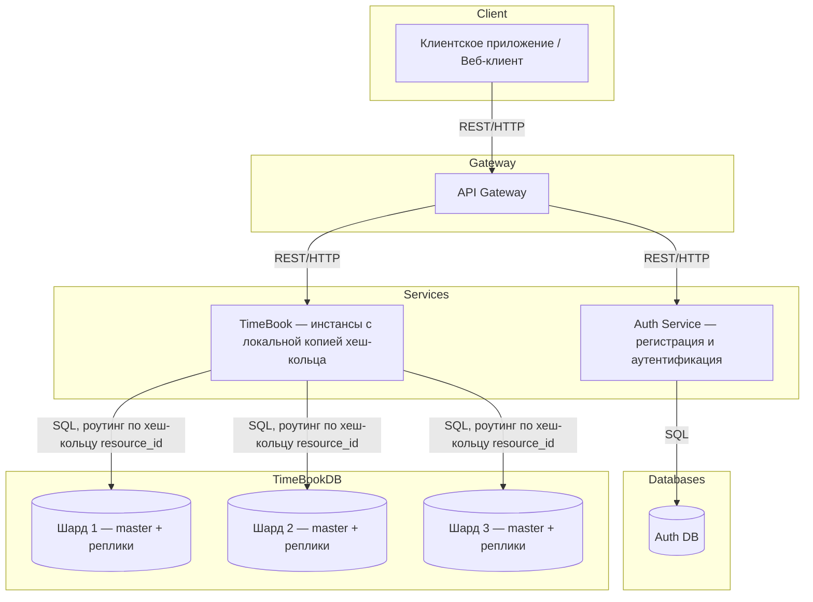
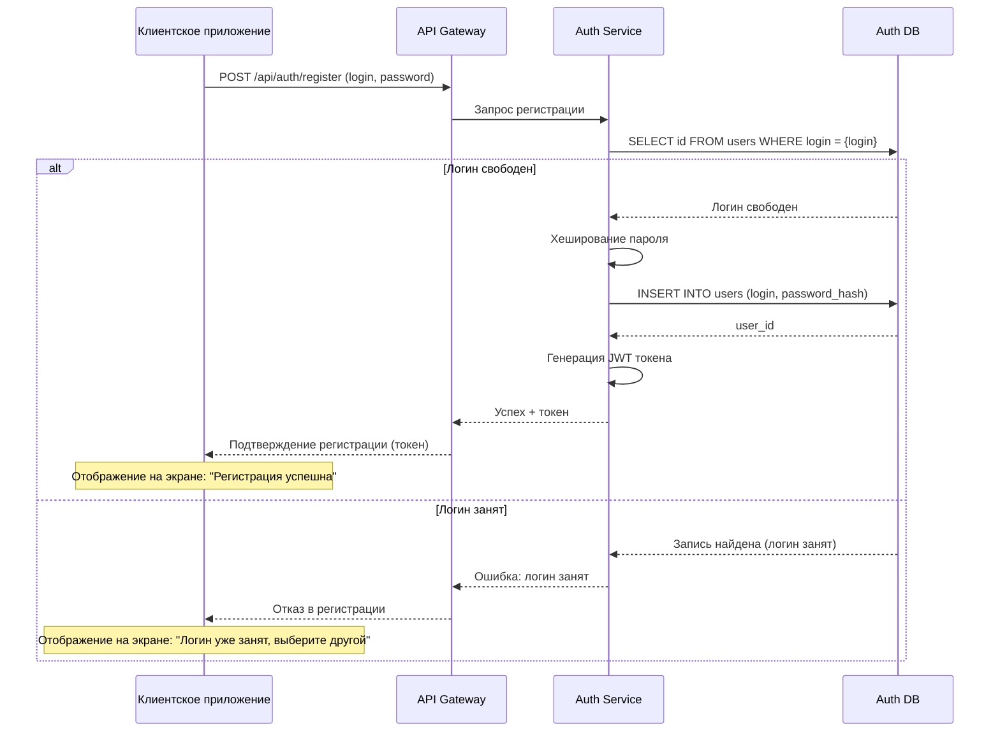
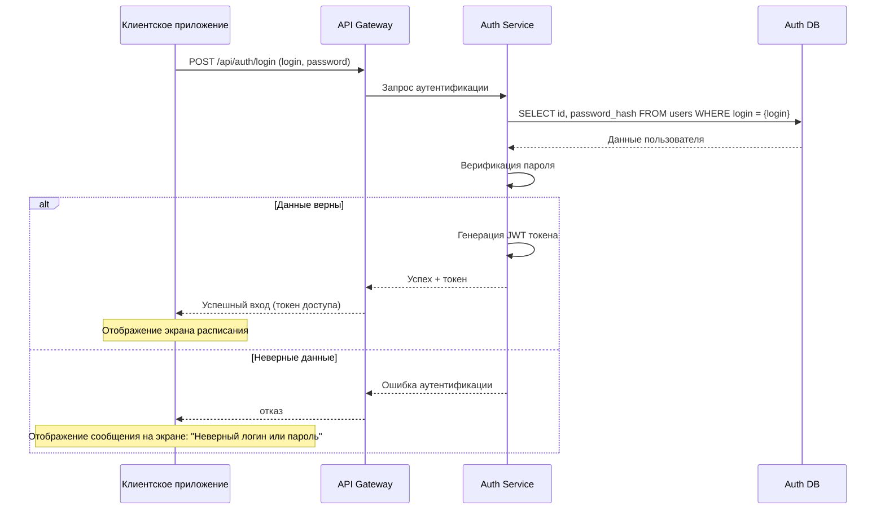
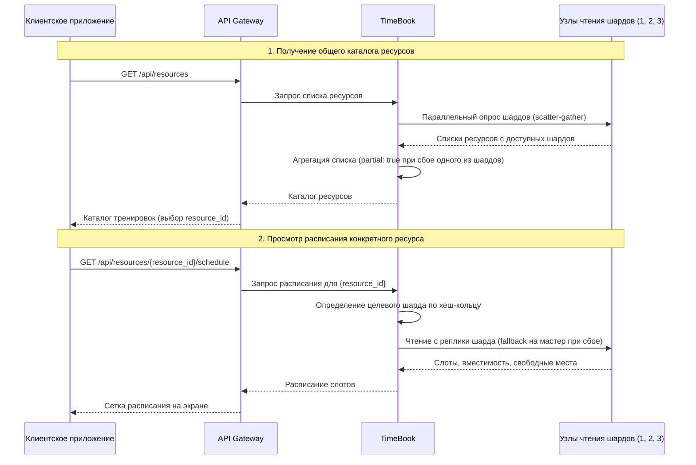
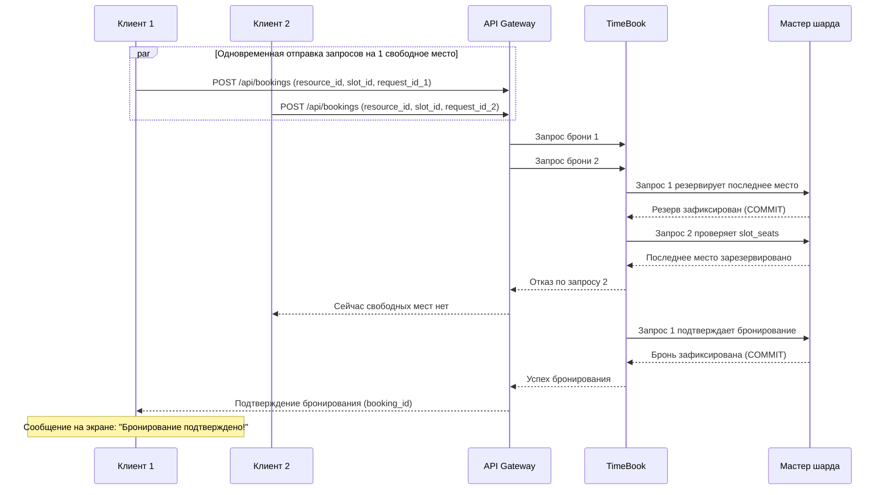
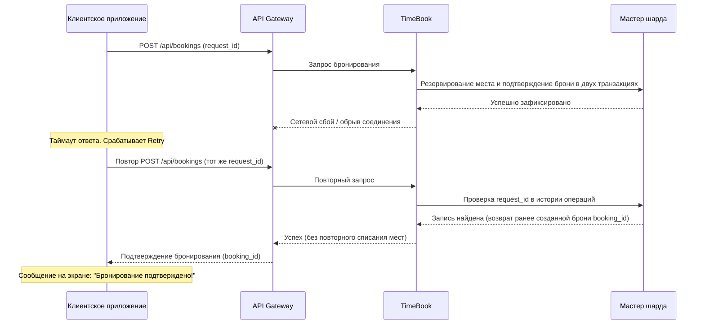
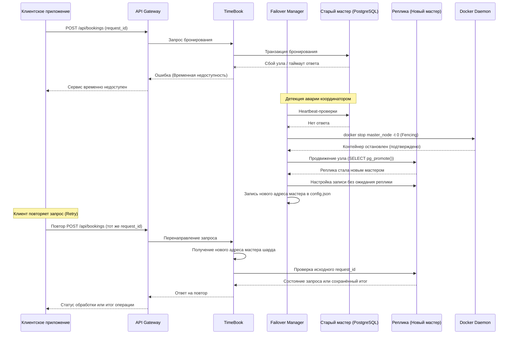

# Техническое решение проекта «Распределенная система бронирования ресурсов "TimeBook"»

## Введение
- **Цель проекта:**  
  Разработать распределённую систему TimeBook для бронирования временных слотов индивидуальных и групповых тренировок с учётом ограниченной вместимости и одновременных запросов пользователей.   

- **Основания для разработки:**  
  Разработка системы выполняется в рамках учебного проекта по курсу «Распределенные системы».

- **Команда:**  

| Участник | Роль |
|---|---|
| Разинова Виктория | Team Lead, Архитектор, DevOps |
| Гмыря Александр | Backend-разработчик 1 |
| Тарасовский Макар | Backend-разработчик 2 |

---

## Глоссарий
| Термин        | Определение |
|---------------|-------------|
| Пользователь  | Зарегистрированный клиент системы, имеющий уникальный логин и пароль. |
| Ресурс  | Объект, доступный для бронирования. Ресурсом может быть индивидуальная тренировка с тренером или групповое занятие. |
| Временной слот  | Фиксированный интервал времени, в течение которого доступен конкретный ресурс для бронирования. |
| Вместимость  | Максимальное количество пользователей, которые могут забронировать один временной слот. Для индивидуальной тренировки вместимость равна 1, для группового занятия может быть больше 1. |
| Бронирование  | Операция закрепления места во временном слоте за конкретным пользователем. |
| Временный резерв | Место, закреплённое за запросом на время оформления бронирования. Пока резерв действует, место недоступно другим пользователям. |
| Загруженность  | Доля занятых мест во временном слоте относительно его вместимости. Используется для отображения степени заполненности слота. |
| Овербукинг  | Ситуация, при которой количество подтверждённых бронирований превышает вместимость временного слота.  |
| Шард  | Независимый сегмент данных, размещенный на отдельном узле или группе узлов. |
| Partitioning  | Распределение ресурсов и связанных с ними данных между несколькими шардами для распределения нагрузки и масштабирования системы. |
| Реплика  | Копия данных, поддерживаемая для обеспечения отказоустойчивости системы. |
| Консистентность  | Свойство системы, обеспечивающее согласованное состояние данных между узлами и репликами. |
| Failover  | Автоматическое переключение на резервный узел при отказе основного. |
| Идемпотентность  | Свойство операции, при котором повторная обработка одного и того же запроса не создаёт дополнительного бронирования. |
| Eventual Consistency  | Модель согласованности, при которой при отсутствии новых обновлений все копии данных со временем сходятся к одному состоянию. |

---

## Функциональные требования
Система должна предоставлять следующие функции:
1. Регистрация и аутентификация пользователей.
2. Просмотр ресурсов, расписания, вместимости и количества свободных мест.
3. Создание бронирования.
4. Обработка параллельных запросов.
5. Отображение состояния запроса на бронирование. Пользователь видит подтверждение брони, сообщение об отсутствии мест, статус «Запрос обрабатывается» или сообщение о временной недоступности операции.

---

## Нефункциональные требования
- **Масштабируемость:** система должна поддерживать запуск с различным количеством узлов и шардов без изменения логики обработки бронирований.
- **Распределённость:** распределение данных между несколькими независимыми узлами без единого центрального узла хранения и обработки всех бронирований. 
- **Отказоустойчивость:** система должна продолжать работу при отказе отдельного узла; для каждого шарда используется резервная реплика, при отказе основного узла выполняется переключение на резервный узел (failover).
- **Консистентность.** Количество подтверждённых бронирований не превышает вместимость слота. Проверка доступности места и создание резерва выполняются атомарно. Создание брони, изменение состояния места и сохранение результата запроса выполняются атомарно на втором этапе.
- **Устойчивость к сетевым ошибкам:** использование тайм-аутов и повторных попыток; повторная отправка запроса не приводит к повторному бронированию; для идентификации операций используется уникальный `request_id`.
- **Параллельная обработка.** Запросы на разные места одного слота могут выполняться параллельно. Если последнее место уже зарезервировано, другой пользователь получает ответ без ожидания завершения оформления брони.
- **Согласованность некритичных данных:** расписание на реплике может обновляться с задержкой. При отсутствии новых изменений данные на реплике сходятся с данными мастера (eventual consistency). Доступность места при бронировании проверяется на мастере.
- **Приоритет согласованности:** при сетевых разделениях согласованность критических операций имеет приоритет над доступностью; при невозможности определить актуальное состояние ресурса бронирование временно отклоняется.

---

## Пользовательские сценарии
### Сценарий: регистрация нового пользователя
1. Пользователь вводит логин и пароль.
2. Система проверяет уникальность логина.
3. При успешной проверке система создаёт учётную запись.
4. При занятом логине система отклоняет регистрацию.

### Сценарий: аутентификация
1. Пользователь вводит логин и пароль.
2. Система проверяет введённые данные.
3. При корректных данных система предоставляет доступ.
4. При некорректных данных система отклоняет вход.

### Сценарий: просмотр ресурсов и расписания
1. Пользователь открывает список тренировок.
2. Система отображает доступные тренировки и их расписание.
3. Система отображает вместимость и количество свободных мест.
4. Пользователь выбирает нужный временной слот.

### Сценарий: бронирование
1. Пользователь выбирает временной слот.
2. Пользователь подтверждает бронирование.
3. Система проверяет наличие свободного места и создаёт временный резерв.
4. Система подтверждает бронь после успешного оформления резерва.
5. При отсутствии свободных мест, система не создаёт бронирование и сообщает пользователю об отказе.
6. Если у пользователя уже есть подтверждённая бронь на этот слот, система сообщает об этом.

### Сценарий: одновременное бронирование
1. Вместимость временного слота равняется 1 месту, или оно является последним свободным.
2. Два пользователя одновременно отправляют запрос на бронирование этого слота.
3. Система резервирует последнее место за одним запросом. Если в групповом слоте есть другое доступное место, второй запрос может занять его.
4. Если других мест нет, второй пользователь получает сообщение «Сейчас свободных мест нет», пока первая бронь ещё оформляется.
5. Количество подтверждённых бронирований не превышает вместимость слота.

### Сценарий: повторная отправка запроса
1. Пользователь повторно отправляет запрос после сетевой ошибки.
2. Система проверяет `request_id`.
3. Система возвращает статус «Запрос обрабатывается» или сохранённый результат. Если запрос ещё не зарегистрирован, система обрабатывает его.
4. Повторное бронирование не создаётся.

### Сценарий: отказ узла
1. Пользователь выполняет операцию бронирования.
2. Основной узел становится недоступен.
3. Система переключает обработку на резервный узел.
4. Пользователь повторяет прерванную операцию.
5. Система обрабатывает запрос и отображает его результат; повторное бронирование не создаётся.
6. Если актуальное состояние бронирования определить невозможно, система временно отклоняет операцию.
7. Пользователь видит сообщение о временной недоступности, а неподтверждённое бронирование не считается успешным.

---

## Архитектура системы

Основные компоненты:

1. **API Gateway** — входная точка в систему, отвечает за маршрутизацию клиентских запросов по REST/HTTP, проверку аутентификации, базовую валидацию и ограничение частоты входящих запросов.
2. **Auth Service** — сервис аутентификации пользователей; отвечает за регистрацию новых клиентов, проверку уникальности логина, верификацию паролей и выпуск токенов доступа.
3. **Auth DB** — база данных учетных записей пользователей сервиса Auth Service; изолирует персональные данные клиентов от расписания и транзакций бронирования.
4. **TimeBook (Сервис бронирований)** — основной сервис системы, отвечающий за проверку расписания, учет вместимости слотов и оформление бронирований; состоит из нескольких независимых инстансов, каждый из которых держит локальную копию хеш-кольца и маршрутизирует `resource_id` → шард без центрального координатора.
5. **TimeBook DB** — транзакционная база данных бронирований, разделенная на 3 логических шарда (`shard_1`, `shard_2`, `shard_3`) с общим числом виртуальных узлов кольца 300 (по 100 на шард). Каждый шард организован в конфигурации single-master с репликой; адреса узлов монтируются в сервисы единым файлом `config.json`.

### Шардирование и репликация TimeBook DB

- **Проблема:** объём расписания и параллельная нагрузка при бронировании популярных слотов превышают возможности одного узла; узлы базы данных могут выходить из строя.
- **Решение:** ресурсы распределяются между тремя логическими шардами методом consistent hashing: идентификаторы шардов через 100 виртуальных узлов на каждый шард и ключи `resource_id` отображаются на кольцо, ключ закрепляется за ближайшим узлом по часовой стрелке. Хеш-кольцо определяет логический шард-владелец и не зависит от физических адресов машин. Внутри каждого шарда работает single-master репликация на базе PostgreSQL: мастер ожидает подтверждения записи в WAL от синхронной реплики. В штатном режиме чтение расписания выполняется с реплик, а при недоступности реплики или после failover автоматически переключается (fallback) на действующий мастер шарда. Переключение ролей внутри шарда выполняет Failover Manager: он изолирует сбойный узел (fencing) принудительной остановкой контейнера через Docker API (`docker stop -t 0`). Только после подтверждения остановки контейнера координатор переводит реплику в статус мастера вызовом `SELECT pg_promote()` и обновляет адреса в общем файле `config.json`; если подтвердить остановку нельзя, промоут откладывается для исключения split-brain. Экземпляры TimeBook перечитывают `config.json` при сетевой ошибке подключения к прежнему мастеру. Перераспределение данных при изменении числа шардов выполняется утилитой миграции. На время переноса запись для затрагиваемых ресурсов приостанавливается. Связанные записи таблиц `resources`, `slots`, `slot_seats`, `bookings` и `idempotency_keys` копируются на новый шард и проверяются. После успешной проверки обновляется конфигурация хеш-кольца на экземплярах TimeBook, и запись возобновляется. До завершения переключения старый шард остаётся владельцем переносимых данных.
- **Гарантия:** детерминированная балансировка нагрузки по шардам; при изменении состава узлов мигрируют только диапазоны ключей соседних сегментов хеш-кольца со связанными записями идемпотентности; подтверждённые бронирования сохраняются при аварии мастера; изоляция старого узла исключает split-brain.
- **Компромиссы:** синхронная репликация увеличивает задержку записи. При отказе единственной реплики запись на этом шарде временно недоступна, а расписание читается с мастера. После failover новый мастер принимает записи без ожидания синхронной реплики до её подключения. Записи за этот период могут быть потеряны при отказе нового мастера.

### Обеспечение консистентности и идемпотентность

- **Проблема:** параллельные запросы на последние места могут привести к овербукингу; обрыв сетевого соединения может вынудить клиента отправить повторный запрос бронирования.
- **Решение:** бронирование выполняется на мастере шарда в две транзакции. В таблице `slot_seats` заранее создаётся по одной записи на каждое место слота. В первой транзакции сервис пробует захватить ключ конкретного места через `pg_try_advisory_xact_lock`. Если ключ занят, сервис сразу проверяет следующее место. После захвата сервис повторно проверяет доступность места, записывает временный резерв с `request_id` и сроком действия, сохраняет в `idempotency_keys` статус «Запрос обрабатывается» и фиксирует транзакцию. Другие запросы видят резерв в таблице. Если доступных мест нет, сервис сразу отвечает «Сейчас свободных мест нет». Во второй транзакции сервис проверяет, что резерв ещё действует и принадлежит этому запросу, создаёт запись в `bookings`, отмечает место в `slot_seats` как забронированное и сохраняет результат в `idempotency_keys`. Ограничение `UNIQUE (slot_id, seat_no)` допускает одну бронь на место, а `UNIQUE (slot_id, user_id)` — одну бронь пользователя на слот. При ошибке оформления сервис освобождает резерв и сохраняет итог запроса. Если обработка прервалась, просроченный резерв освобождается при следующей попытке занять место или при проверке состояния запроса. При освобождении просроченного резерва сервис в той же транзакции сохраняет в idempotency_keys итог «Срок резерва истёк».Подтверждение и освобождение используют один и тот же ключ места. После захвата ключа сервис повторно проверяет владельца резерва и срок его действия. Для защиты от одновременных повторов сервис использует отдельный неблокирующий захват по `request_id`. Повтор с тем же `request_id` получает статус «Запрос обрабатывается» или сохранённый итог. Расписание читается с реплик и может обновляться с задержкой.
- **Гарантия:** количество подтверждённых бронирований слота не превышает его вместимость. Повторная отправка успешно выполненного запроса с тем же `request_id` не создаёт второе бронирование и возвращает сохранённый результат.
- **Компромиссы:** для оформления брони нужны две транзакции. Пока резерв действует, место недоступно другим пользователям. При повторной отправке клиент использует исходный `request_id`.

### Обработка частичных отказов

- **Проблема:** узел может отказать, зависнув или прекратив отвечать по сети; важно отличать медленный узел от отказавшего.
- **Решение:** детекция недоступности по таймаутам запросов и периодическим health-проверкам (heartbeat). Реакция: повтор запроса (retry) клиентом с экспоненциальной задержкой, автоматический failover мастера шарда на реплику. Если актуальное состояние бронирования или статус мастера шарда определить невозможно, операция временно отклоняется.
- **Гарантия:** при отказе отдельного узла система продолжает обслуживать запросы к остальным шардам, а отказавший шард восстанавливает обработку после переключения на реплику; неподтверждённое бронирование не считается успешным.
- **Компромиссы:** короткий таймаут порождает ложные срабатывания (медленный узел принимается за отказавший), чересчур длинный — замедляет реакцию; на время назначения реплики новым мастером операции записи на данный шард временно недоступны.

---

## Технические сценарии

### Сценарий: регистрация нового пользователя

1. Клиент вводит регистрационные данные и отправляет в API Gateway запрос `POST /api/auth/register` с параметрами `login` и `password`.
2. API Gateway валидирует входной формат и перенаправляет запрос в сервис AuthService.
3. AuthService обращается к Auth DB с проверкой уникальности логина.
4. При свободном логине AuthService хеширует пароль и сохраняет запись в Auth DB.
5. AuthService генерирует токен доступа и возвращает ответ клиенту. На экране клиента отображается сообщение об успешной регистрации. При занятом логине возвращается ошибка, и на экран выводится сообщение о необходимости выбрать другой логин.

---

### Сценарий: аутентификация пользователя

1. Клиент отправляет в API Gateway запрос `POST /api/auth/login` с параметрами `login` и `password`.
2. API Gateway передаёт запрос в сервис AuthService.
3. AuthService запрашивает хеш пароля пользователя из Auth DB по его `login`.
4. AuthService сверяет хеш введённого пароля с хранимым значением.
5. При совпадении AuthService формирует токен доступа и возвращает его через API Gateway клиенту. Клиент переходит к экрану расписания. При несовпадении данных возвращается отказ, и на экране отображается сообщение «Неверный логин или пароль».

---

### Сценарий: просмотр ресурсов и расписания

1. Для отображения каталога клиент отправляет запрос `GET /api/resources`. Сервис TimeBook параллельно опрашивает узлы чтения всех трёх шардов (паттерн scatter-gather). Если один из шардов недоступен или не ответил за отведённое время, сервис возвращает агрегированный список тренировок с доступных шардов с флагом частичного каталога (`partial: true`), не блокируя работу исправной части системы. Клиент выбирает интересующую тренировку и получает её `resource_id`.
2. Клиент отправляет запрос на получение расписания выбранного ресурса: `GET /api/resources/{resource_id}/schedule`.
3. Сервер TimeBook по хеш-кольцу определяет целевой шард для `resource_id` и направляет запрос на чтение к реплике этого конкретного шарда. Если реплика недоступна по таймауту (или после failover шард работает в одну копию), сервис автоматически перенаправляет запрос на чтение действующему мастеру шарда (fallback).
4. Реплика (или мастер в режиме fallback) возвращает временные слоты, их вместимость и число свободных мест с учётом действующих резервов.
5. TimeBook возвращает расписание клиенту, и на экране обновляется сетка доступных слотов для записи.

---

### Сценарий: бронирование слота и обработка параллельных запросов

1. Пользователи одновременно отправляют запрос на бронирование последнего свободного места в слоте. Приложения передают идентификатор ресурса, номер слота и уникальный ключ запроса (`request_id`) для защиты от дублирования.
2. API Gateway передаёт запросы в сервис TimeBook. Сервис детерминированно вычисляет целевой узел по цепочке: `resource_id = 42` → хеш попадает на виртуальный узел `shard_2#vnode_15` → логический шард `shard_2` → актуальный адрес мастера `shard_2_master`. Сервис направляет обе операции на мастер этого шарда.
3. Первый запрос занимает последнее место и фиксирует временный резерв в `slot_seats`.
4. Второй запрос видит резерв в `slot_seats` и сразу получает ответ «Сейчас свободных мест нет».
5. Первый запрос подтверждает бронь во второй транзакции. После её фиксации клиент получает сообщение «Бронирование успешно подтверждено!».
6. Если второй запрос проверяет место до фиксации резерва, он пробует захватить ключ места. Если ключ занят, сервис сразу проверяет другое место или возвращает «Сейчас свободных мест нет».

---

### Сценарий: повторная отправка запроса (идемпотентность)

1. Клиент подтверждает бронирование. Приложение генерирует уникальный идентификатор операции (`request_id`) и отправляет запрос через API Gateway.
2. Сервис регистрирует `request_id` при резервировании места и сохраняет итог при подтверждении брони.
3. Если ответ задерживается или теряется из-за сетевого сбоя, клиентское приложение автоматически выполняет повторную отправку с тем же `request_id`.
4. При повторе с тем же `request_id` сервис возвращает статус «Запрос обрабатывается» или сохранённый результат. Повтор не занимает дополнительное место.
5. На экране клиента отображается сообщение об успешном бронировании. Лишнее место не списано.

---

### Сценарий: отказ мастера шарда и failover

1. В процессе работы мастер одного из шардов TimeBook DB аварийно завершает работу.
2. Сервис TimeBook при попытке записи фиксирует ошибку соединения по таймауту и возвращает клиенту сообщение о временной недоступности операции.
3. Служебный координатор отказоустойчивости (Failover Manager) на основе серии heartbeat-проверок констатирует сбой мастера. Для гарантированного прекращения записи и закрытия соединений координатор выполняет fencing вызовом `docker stop -t 0` для контейнера мастера. Получив подтверждение статуса остановки от Docker daemon, координатор продвигает реплику командой `SELECT pg_promote()`. Если подтверждение не получено, промоут откладывается ради сохранения согласованности.
4. Перед публикацией нового адреса координатор настраивает новый мастер на запись без ожидания синхронной реплики (`synchronous_standby_names = ''`). Координатор записывает новый адрес мастера шарда в общий монтируемый файл `config.json`. Экземпляры TimeBook фиксируют разрыв соединения со старым мастером, перечитывают `config.json` и перенаправляют запись на новый мастер.
5. Клиентское приложение повторяет прерванную сетевую операцию с исходным `request_id`.
6. TimeBook проверяет исходный `request_id` на новом мастере. Если сохранился итог, сервис возвращает его. При действующем резерве сервис возвращает статус «Запрос обрабатывается». Если запрос ещё не зарегистрирован, сервис обрабатывает его по обычным правилам.

---

## План разработки и тестирования

**Включает:**
- Реализация клиентского интерфейса (веб/мобильный клиент) с поддержкой повторных запросов (retry) и генерацией `request_id`.
- Реализация API Gateway для валидации входящего потока запросов, маршрутизации вызовов и проверки токенов доступа.
- Реализация сервиса аутентификации (Auth Service) и базы данных Auth DB для безопасного хранения пользователей и выпуска JWT.
- Реализация распределённого сервиса бронирования TimeBook с маршрутизацией запросов по локальной копии хеш-кольца (consistent hashing).
- Реализация шардированной базы данных TimeBook DB (мастер-реплика на каждом шарде) с атомарными транзакциями, таблицей мест slot_seats и таблицей идемпотентности.
- Инициализация тестовых данных (Seed data): подготовка SQL-скрипта первичного наполнения (`init_seed.sql`), монтируемого в контейнеры шардов PostgreSQL при старте через Docker Compose, с готовым набором ресурсов, временных слотов и записей о местах по вместимости каждого слота для демонстрации прототипа.
- Реализация механизма автоматического переключения при авариях (failover) с назначением реплики новым мастером и изоляцией сбойного узла (fencing).
- Реализация утилиты миграции данных шардов для регламентного переноса связанных сущностей при перебалансировке хеш-кольца.

**План разработки:**
1. Проектирование схемы реляционной базы данных: таблицы пользователей в Auth DB; таблицы ресурсов, слотов, мест, бронирований и таблицы идемпотентности (`request_id`) в TimeBook DB.
2. Разработка сервиса аутентификации (`Auth Service`): регистрация с хешированием паролей, верификация данных и генерация JWT-токенов доступа.
3. Разработка модуля API Gateway: проверка JWT, валидация входных JSON-структур и маршрутизация REST-запросов между AuthService и инстансами TimeBook.
4. Разработка модуля согласованного хеширования (`Consistent Hashing`): построение виртуального хеш-кольца по `resource_id` для детерминированного выбора целевого шарда узлами TimeBook.
5. Разработка логики чтения расписания (Read-Write Split): направление запросов чтения расписания на реплики шардов для снижения нагрузки на мастер.
6. Разработка транзакционного бронирования слотов: резервирование конкретного места, подтверждение брони и освобождение просроченного резерва.
7. Реализация механизма идемпотентности: сохранение и верификация `request_id` на этапах резервирования и подтверждения брони для защиты от повторных списаний при сетевых сбоях.
8. Разработка подсистемы мониторинга доступности и Failover: фоновые heartbeat-проверки мастера шарда, процедура автоматического назначения реплики новым мастером и изоляция (fencing) старого узла.
9. Разработка клиентского приложения: экраны авторизации, сетки расписания и бронирования слотов; встроенная логика повтора запросов (Retry) по таймауту с сохранением исходного `request_id`.
10. Подготовка окружения и сценариев развёртывания кластера (Docker Compose): запуск API Gateway, сервисов TimeBook, Auth DB и 3 шардов TimeBook DB с настроенной репликацией.
11. Разработка утилиты миграции данных шардов: скрипт переноса записей ресурсов, слотов, мест, бронирований и таблицы `request_id` при перебалансировке сегментов хеш-кольца с временной блокировкой записи для перемещаемых ключей.

**План тестирования:**
- **Тестирование Consistent Hashing и перераспределения данных:** проверка детерминированного выбора узла по 300 vnodes; симуляция добавления 4-го шарда со служебным переносом строк только затронутых ресурсов, их слотов, мест, броней и записей `request_id` без нарушения целостности данных.
- **Интеграционное тестирование аутентификации:** проверка регистрации пользователя, отсечения дублирующихся логинов и валидации срока действия выпущенного токена доступа.
- **Тест распределения нагрузки (Read/Write Split):** проверка того, что запросы на получение расписания (GET) уходят на реплики шарда, при их отказе автоматически перенаправляются на действующий мастер (fallback), а запросы бронирования (POST) попадают строго на мастер.
- **Нагрузочный тест параллельного бронирования (Race Condition):** остановить первый запрос после фиксации резерва. Проверить, что второй запрос получает отказ до возобновления первого. После возобновления проверить, что создана одна бронь. Отдельно проверить гонку до фиксации резерва и бронирование двух свободных мест в групповом слоте.
- **Тест идемпотентности при сетевом сбое:** симуляция как последовательного повтора запроса по таймауту, так и одновременной отправки двух одинаковых `request_id` на разные инстансы сервиса (in-flight retry); проверка отсутствия двойного списания мест и возврата одинакового результата бронирования после завершения операции.
- **Eventual consistency расписания:** задержать применение обновлений на реплике, выполнить бронь на мастере и проверить, что реплика временно показывает старое число мест. После возобновления применения обновлений проверить, что число мест совпало.
- **Частичный каталог при отказе шарда:** сделать недоступными мастер и реплику одного шарда. Проверить, что `GET /api/resources` за отведённое время возвращает тренировки с остальных шардов и `partial: true`.
- **Истечение резерва:** прервать оформление после фиксации резерва. После истечения срока проверить, что другой запрос может занять место, а исходный запрос не может подтвердить просроченный резерв.
- **Тест отказоустойчивости мастера шарда (Failover):** принудительное отключение процесса мастера во время работы; проверка обнаружения отказа координатором (Failover Manager), выполнения fencing и продвижения реплики через `pg_promote()`; верификация сохранности ранее подтверждённого бронирования и его `request_id` на новом мастере, а также успешного завершения повторного запроса клиента.
- **Тест изоляции узла (Fencing):** проверка невозможности записи старых данных на прежний мастер в случае его восстановления после состоявшегося failover.

**Definition of Done (DoD):**
- Запущен распределённый кластер: API Gateway, AuthService, не менее двух инстансов сервиса TimeBook и ровно 3 шарда TimeBook DB (каждый в конфигурации «мастер + реплика»).
- Проведена успешная регистрация и вход пользователя с получением JWT-токена, используемого для доступа к эндпоинтам расписания и бронирования.
- Ресурсы по фиксированному алгоритму распределяются между шардами по хеш-кольцу без единого централизованного координатора.
- При добавлении шарда выполняется перенос затронутых ресурсов и связанных с ними слотов, мест, бронирований и записей `idempotency_keys`; после переноса данные доступны, ранее подтверждённые бронирования сохранены.
- При конкуренции за последнее место второй запрос получает ответ до завершения оформления первой брони. На одно место создаётся не более одной подтверждённой брони.
- Повторная отправка успешно выполненного запроса с тем же `request_id` не приводит к повторному списанию мест и возвращает исходный результат бронирования.
- При аварийной остановке мастера шарда система автоматически переключает операции записи на реплику, позволяя клиенту успешно завершить операцию.