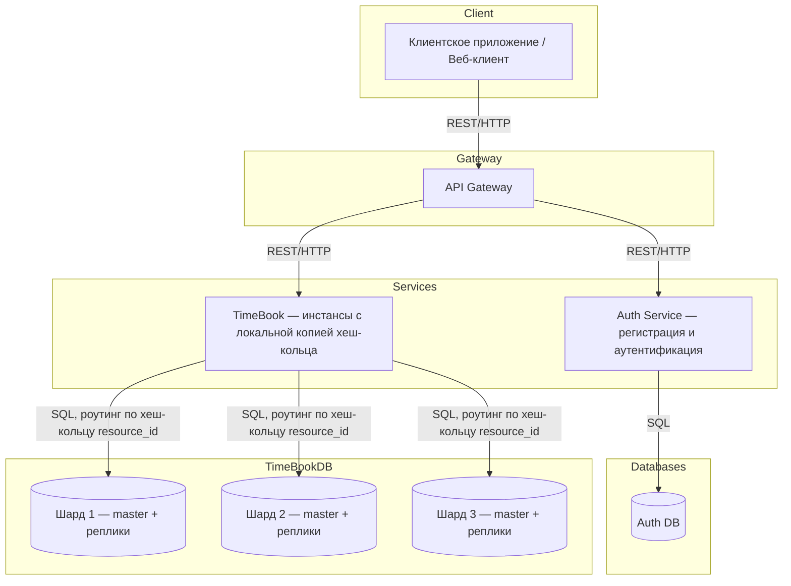
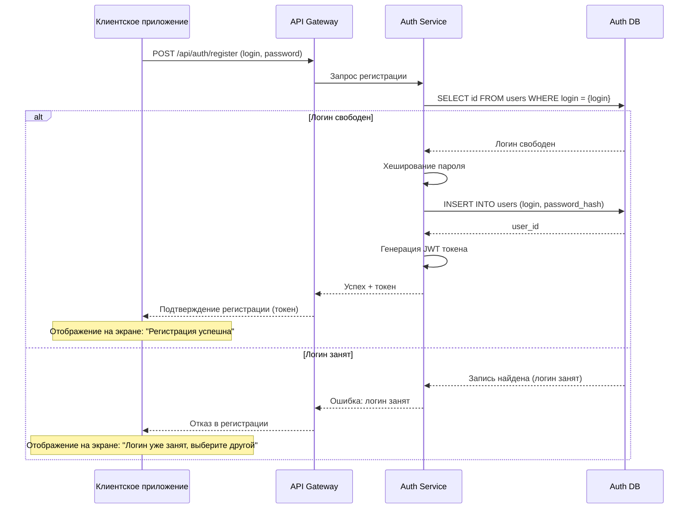
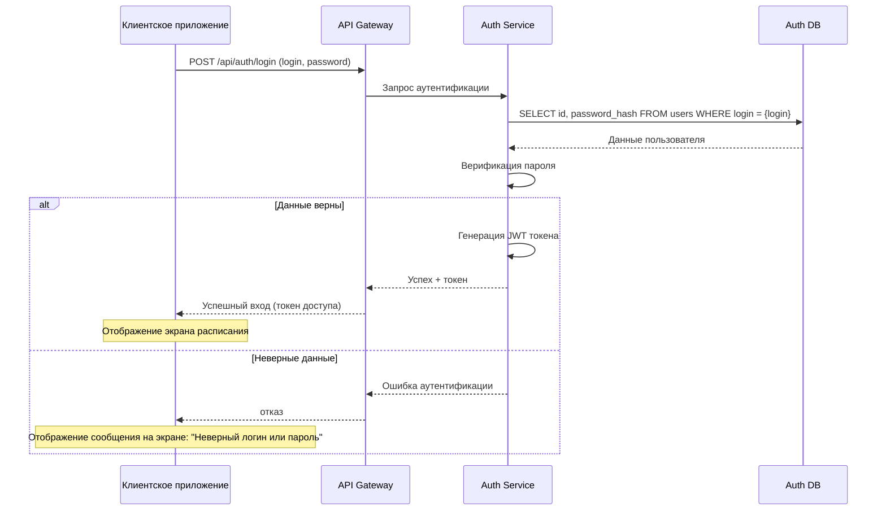
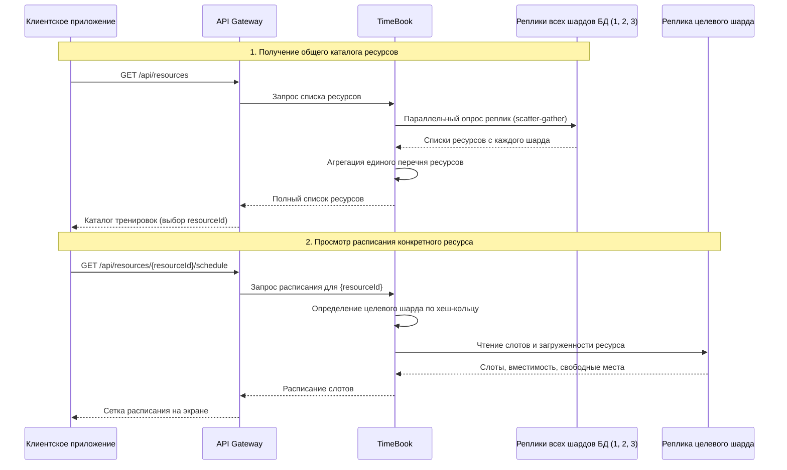
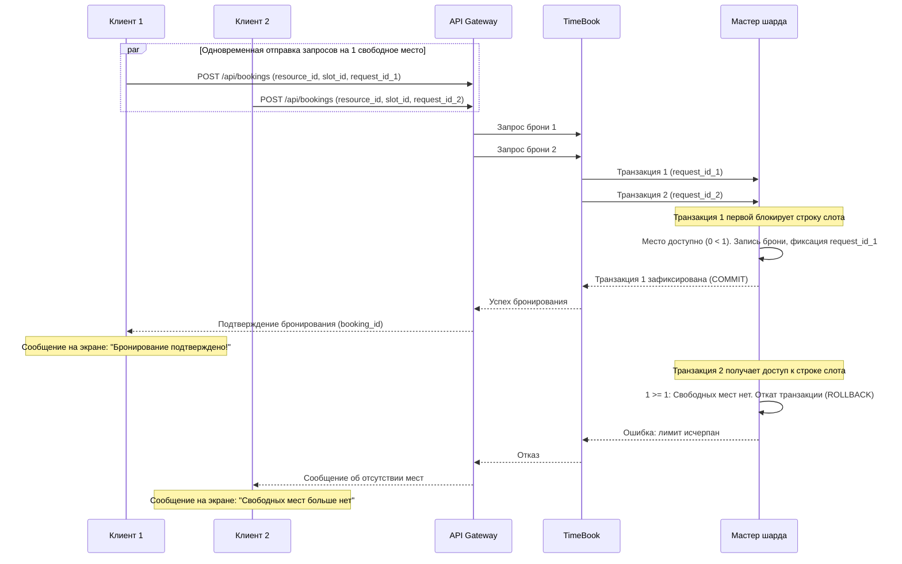
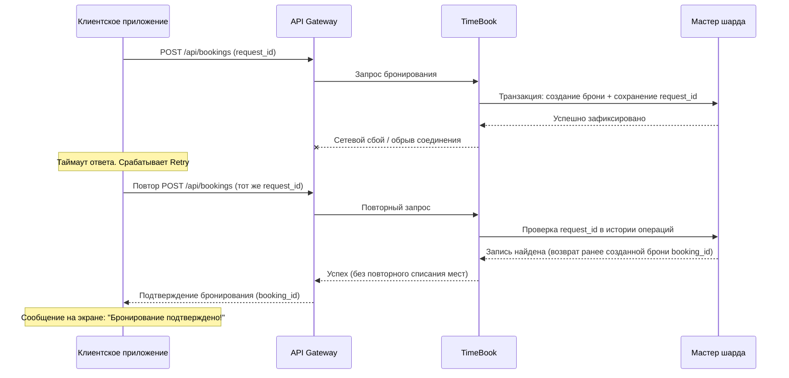
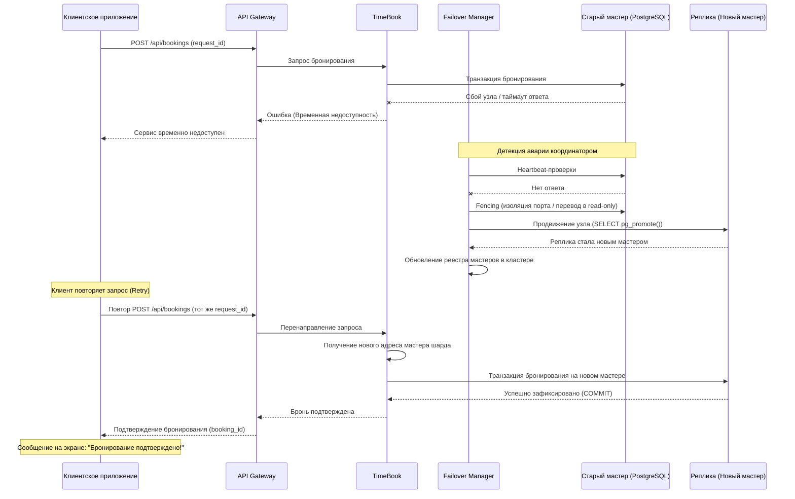

# Техническое решение проекта «Распределенная система бронирования ресурсов "TimeBook"»

## Введение
- **Цель проекта:**  
  Разработать распределённую систему TimeBook для бронирования временных слотов индивидуальных и групповых тренировок с учётом ограниченной вместимости и одновременных запросов пользователей.   

- **Основания для разработки:**  
  Разработка системы выполняется в рамках учебного проекта по курсу «Распределенные системы».

- **Команда:**  

| Участник | Роль |
|---|---|
| Разинова Виктория | Team Lead, Архитектор |
| Гмыря Александр | Backend-разработчик 1 |
| Тарасовский Макар | Backend-разработчик 2 |
| Юрлова Елена | DevOps, тестировщик |

---

## Глоссарий
| Термин        | Определение |
|---------------|-------------|
| Пользователь  | Зарегистрированный клиент системы, имеющий уникальный логин и пароль. |
| Ресурс  | Объект, доступный для бронирования. Ресурсом может быть индивидуальная тренировка с тренером или групповое занятие. |
| Временной слот  | Фиксированный интервал времени, в течение которого доступен конкретный ресурс для бронирования. |
| Вместимость  | Максимальное количество пользователей, которые могут забронировать один временной слот. Для индивидуальной тренировки вместимость равна 1, для группового занятия может быть больше 1. |
| Бронирование  | Операция закрепления места во временном слоте за конкретным пользователем. |
| Загруженность  | Доля занятых мест во временном слоте относительно его вместимости. Используется для отображения степени заполненности слота. |
| Овербукинг  | Ситуация, при которой количество подтверждённых бронирований превышает вместимость временного слота.  |
| Шард  | Независимый сегмент данных, размещенный на отдельном узле или группе узлов. |
| Partitioning  | Распределение ресурсов и связанных с ними данных между несколькими шардами для распределения нагрузки и масштабирования системы. |
| Реплика  | Копия данных, поддерживаемая для обеспечения отказоустойчивости системы. |
| Консистентность  | Свойство системы, обеспечивающее согласованное состояние данных между узлами и репликами. |
| Failover  | Автоматическое переключение на резервный узел при отказе основного. |
| Идемпотентность  | Свойство операции, при котором повторная обработка одного и того же запроса не создаёт дополнительного бронирования. |
| Eventual Consistency  | Модель согласованности, при которой при отсутствии новых обновлений все копии данных со временем сходятся к одному состоянию. |

---

## Функциональные требования
Система должна предоставлять следующие функции:
1. Регистрация и аутентификация пользователей.
2. Просмотр ресурсов, расписания, вместимости и количества свободных мест.
3. Создание бронирования.
4. Обработка параллельных запросов.
5. Отображение результата бронирования: успешное создание, отсутствие свободных мест или временная недоступность операции.

---

## Нефункциональные требования
- **Масштабируемость:** система должна поддерживать запуск с различным количеством узлов и шардов без изменения логики обработки бронирований.
- **Распределённость:** распределение данных между несколькими независимыми узлами без единого центрального узла хранения и обработки всех бронирований. 
- **Отказоустойчивость:** система должна продолжать работу при отказе отдельного узла; для каждого шарда используется резервная реплика, при отказе основного узла выполняется переключение на резервный узел (failover).
- **Консистентность:** отсутствие превышения вместимости ресурса; проверка доступности места и создание бронирования выполняются атомарно.
- **Устойчивость к сетевым ошибкам:** использование тайм-аутов и повторных попыток; повторная отправка запроса не приводит к повторному бронированию; для идентификации операций используется уникальный `request_id`.
- **Асинхронная обработка:** система должна корректно обрабатывать одновременно поступающие запросы на бронирование; количество подтверждённых бронирований не должно превышать вместимость ресурса.
- **Согласованность некритичных данных:** допускается eventual consistency для данных, не влияющих непосредственно на результат бронирования; информация о загрузке и расписании может обновляться с задержкой.
- **Приоритет согласованности:** при сетевых разделениях согласованность критических операций имеет приоритет над доступностью; при невозможности определить актуальное состояние ресурса бронирование временно отклоняется.

---

## Пользовательские сценарии
### Сценарий: регистрация нового пользователя
1. Пользователь вводит логин и пароль.
2. Система проверяет уникальность логина.
3. При успешной проверке система создаёт учётную запись.
4. При занятом логине система отклоняет регистрацию.

### Сценарий: аутентификация
1. Пользователь вводит логин и пароль.
2. Система проверяет введённые данные.
3. При корректных данных система предоставляет доступ.
4. При некорректных данных система отклоняет вход.

### Сценарий: просмотр ресурсов и расписания
1. Пользователь открывает список тренировок.
2. Система отображает доступные тренировки и их расписание.
3. Система отображает вместимость и количество свободных мест.
4. Пользователь выбирает нужный временной слот.

### Сценарий: бронирование
1. Пользователь выбирает временной слот.
2. Пользователь подтверждает бронирование.
3. Система проверяет наличие свободного места.
4. Система создаёт бронирование при наличии свободного места.
5. При отсутствии свободных мест, система не создаёт бронирование и сообщает пользователю об отказе.
6. Если к моменту подтверждения слот уже занят другим пользователем, система отклоняет бронирование и сообщает пользователю об отсутствии свободных мест.

### Сценарий: одновременное бронирование
1. Вместимость временного слота равняется 1 месту, или оно является последним свободным.
2. Два пользователя одновременно отправляют запрос на бронирование этого слота.
3. Система обрабатывает оба запроса с учётом текущей вместимости.
4. Один пользователь получает подтверждение бронирования, второй - отказ из-за отсутствия свободных мест.
5. Количество подтверждённых бронирований не превышает вместимость слота.

### Сценарий: повторная отправка запроса
1. Пользователь повторно отправляет запрос после сетевой ошибки.
2. Система проверяет `request_id`.
3. Система возвращает результат ранее выполненной операции либо выполняет запрос.
4. Повторное бронирование не создаётся.

### Сценарий: отказ узла
1. Пользователь выполняет операцию бронирования.
2. Основной узел становится недоступен.
3. Система переключает обработку на резервный узел.
4. Пользователь повторяет прерванную операцию.
5. Система обрабатывает запрос и отображает его результат; повторное бронирование не создаётся.
6. Если актуальное состояние бронирования определить невозможно, система временно отклоняет операцию.
7. Пользователь видит сообщение о временной недоступности, а неподтверждённое бронирование не считается успешным.

---

## Архитектура системы

Основные компоненты:

1. **API Gateway** — входная точка в систему, отвечает за маршрутизацию клиентских запросов по REST/HTTP, проверку аутентификации, базовую валидацию и ограничение частоты входящих запросов.
2. **Auth Service** — сервис аутентификации пользователей; отвечает за регистрацию новых клиентов, проверку уникальности логина, верификацию паролей и выпуск токенов доступа.
3. **Auth DB** — база данных учетных записей пользователей сервиса Auth Service; изолирует персональные данные клиентов от расписания и транзакций бронирования.
4. **TimeBook (Сервис бронирований)** — основной сервис системы, отвечающий за проверку расписания, учет вместимости слотов и оформление бронирований; состоит из нескольких независимых инстансов, каждый из которых держит локальную копию хеш-кольца и маршрутизирует `resource_id` → шард без центрального координатора.
5. **TimeBook DB** — транзакционная база данных бронирований, разделенная на 3 логических шарда (`shard_1`, `shard_2`, `shard_3`) с общим числом виртуальных узлов кольца 300 (по 100 на шард). Каждый шард организован в конфигурации single-master с репликой; адреса узлов монтируются в сервисы единым файлом `config.json`.

### Шардирование и репликация TimeBook DB

- **Проблема:** объём расписания и параллельная нагрузка при бронировании популярных слотов превышают возможности одного узла; узлы базы данных могут выходить из строя.
- **Решение:** ресурсы распределяются между тремя логическими шардами методом consistent hashing: идентификаторы шардов через 100 виртуальных узлов на каждый шард и ключи `resource_id` отображаются на кольцо, ключ закрепляется за ближайшим узлом по часовой стрелке. Хеш-кольцо определяет только логический шард-владелец и не зависит от физических адресов машин. Внутри каждого шарда организована single-master репликация на базе PostgreSQL: в штатном режиме мастер ожидает подтверждения записи в журнал (WAL) от синхронной реплики перед фиксацией транзакции. При недоступности реплики либо после выполнения failover шард продолжает обслуживание операций записи в режиме единственной копии до восстановления резервного узла. Переключение ролей внутри шарда выполняет Failover Manager: он изолирует сбойный узел (fencing), переводит реплику в статус мастера вызовом `SELECT pg_promote()` и обновляет реестр точек записи для экземпляров TimeBook без изменения топологии хеш-кольца. Исходный состав шардов и адреса передаются экземплярам через монтируемый файл `config.json`.
- **Гарантия:** детерминированная балансировка нагрузки по шардам; при штатной синхронной репликации подтверждённые бронирования гарантированно сохраняются при аварии мастера; отсутствие овербукинга; изоляция старого узла исключает split-brain.
- **Компромиссы:** синхронная репликация увеличивает задержку записи; при отказе реплики или сразу после failover шард временно работает без резервной копии; стенд работает с фиксированным составом шардов (динамическая миграция строк БД между шардами на лету исключена из рамок учебного проекта).

### Обеспечение консистентности и идемпотентность

- **Проблема:** параллельные запросы на последние места могут привести к овербукингу; обрыв сетевого соединения может вынудить клиента отправить повторный запрос бронирования.
- **Решение:** проверка наличия свободного места и фиксация бронирования выполняются атомарно в рамках одной транзакции на мастере шарда. Каждому запросу бронирования клиент присваивает уникальный ключ `request_id`, защищённый первичным ключом (`PRIMARY KEY`) в таблице идемпотентности шарда. Регистрация ключа выполняется до блокировки строки слота: при параллельном поступлении дубликата во время обработки первого запроса (in-flight retry) второй поток блокируется на первичном ключе (`ON CONFLICT`), дожидается фиксации первой транзакции и возвращает её сохранённый результат без списания дополнительного места и без ложного отказа.
- **Гарантия:** количество подтверждённых бронирований строго равно числу фактически занятых мест (овербукинг равен 0); повторные запросы с одинаковым `request_id` (как последовательные, так и параллельные) всегда возвращают единый результат первой операции.
- **Компромиссы:** пессимистическая блокировка строки слота снижает параллелизм при одновременной записи в один и тот же слот; клиент обязан сохранять и переиспользовать `request_id` при retry.

### Обработка частичных отказов

- **Проблема:** узел может отказать, зависнув или прекратив отвечать по сети; важно отличать медленный узел от отказавшего.
- **Решение:** детекция недоступности по таймаутам запросов и периодическим health-проверкам (heartbeat). Реакция: повтор запроса (retry) клиентом с экспоненциальной задержкой, автоматический failover мастера шарда на реплику. Если актуальное состояние бронирования или статус мастера шарда определить невозможно, операция временно отклоняется.
- **Гарантия:** при отказе отдельного узла система продолжает обслуживать запросы к остальным шардам, а отказавший шард восстанавливает обработку после переключения на реплику; неподтверждённое бронирование не считается успешным.
- **Компромиссы:** короткий таймаут порождает ложные срабатывания (медленный узел принимается за отказавший), чересчур длинный — замедляет реакцию; на время назначения реплики новым мастером операции записи на данный шард временно недоступны.

---

## Технические сценарии

### Сценарий: регистрация нового пользователя

1. Клиент вводит регистрационные данные и отправляет в API Gateway запрос `POST /api/auth/register` с параметрами `login` и `password`.
2. API Gateway валидирует входной формат и перенаправляет запрос в сервис AuthService.
3. AuthService обращается к Auth DB с проверкой уникальности логина.
4. При свободном логине AuthService хеширует пароль и сохраняет запись в Auth DB.
5. AuthService генерирует токен доступа и возвращает ответ клиенту. На экране клиента отображается сообщение об успешной регистрации. При занятом логине возвращается ошибка, и на экран выводится сообщение о необходимости выбрать другой логин.

---

### Сценарий: аутентификация пользователя

1. Клиент отправляет в API Gateway запрос `POST /api/auth/login` с параметрами `login` и `password`.
2. API Gateway передаёт запрос в сервис AuthService.
3. AuthService запрашивает хеш пароля пользователя из Auth DB по его `login`.
4. AuthService сверяет хеш введённого пароля с хранимым значением.
5. При совпадении AuthService формирует токен доступа и возвращает его через API Gateway клиенту. Клиент переходит к экрану расписания. При несовпадении данных возвращается отказ, и на экране отображается сообщение «Неверный логин или пароль».

---

### Сценарий: просмотр ресурсов и расписания

1. Для отображения каталога клиент отправляет запрос `GET /api/resources`. Сервис TimeBook параллельно опрашивает реплики всех трёх шардов (паттерн scatter-gather), агрегирует полученные списки ресурсов в единый перечень и возвращает его клиенту. Клиент выбирает интересующую тренировку и получает её `resourceId`.
2. Клиент отправляет запрос на получение расписания выбранного ресурса: `GET /api/resources/{resourceId}/schedule`.
3. Сервер TimeBook по хеш-кольцу определяет целевой шард для `resourceId` и направляет запрос на чтение к реплике этого конкретного шарда.
4. Реплика возвращает временные слоты, их вместимость и число занятых мест.
5. TimeBook возвращает расписание клиенту, и на экране обновляется сетка доступных слотов для записи.

---

### Сценарий: бронирование слота и обработка параллельных запросов

1. Пользователи одновременно отправляют запрос на бронирование последнего свободного места в слоте. Приложения передают идентификатор ресурса, номер слота и уникальный ключ запроса (`request_id`) для защиты от дублирования.
2. API Gateway передаёт запросы в сервис TimeBook. Сервис детерминированно вычисляет целевой узел по цепочке: `resource_id = 42` → хеш попадает на виртуальный узел `shard_2#vnode_15` → логический шард `shard_2` → актуальный адрес мастера `shard_2_master`. Сервис направляет обе операции на мастер этого шарда.

3. Мастер шарда выстраивает параллельные операции в строгую очередь за счёт временной блокировки строки выбранного слота.
4. Первая транзакция блокирует строку слота, проверяет наличие свободного места, увеличивает счётчик занятых мест, фиксирует бронирование и сохраняет `request_id` в таблице подтверждённых операций.
5. Первый клиент получает подтверждение успешного бронирования. На его экране отображается сообщение «Бронирование успешно подтверждено!».
6. Вторая транзакция получает доступ к строке после завершения первой, считывает обновлённые данные и фиксирует, что лимит мест исчерпан. Транзакция отменяется, и клиенту возвращается отказ из-за отсутствия мест.
7. На экране второго клиента отображается сообщение «Свободных мест больше нет. Пожалуйста, выберите другое время». Овербукинг гарантированно исключён.

---

### Сценарий: повторная отправка запроса (идемпотентность)

1. Клиент подтверждает бронирование. Приложение генерирует уникальный идентификатор операции (`request_id`) и отправляет запрос через API Gateway.
2. Мастер шарда регистрирует `request_id` в таблице идемпотентности через `PRIMARY KEY`, блокирует строку слота и фиксирует бронирование.
3. Если ответ задерживается или теряется из-за сетевого сбоя, клиентское приложение автоматически выполняет повторную отправку с тем же `request_id`.
4. При параллельном поступлении дубликата (in-flight retry) второй запрос ожидает освобождения блокировки первичного ключа `request_id`, считывает результат первой транзакции и возвращает его клиенту. Слот повторно не уменьшается, а при бронировании последнего места исключается ошибочный отказ.
5. На экране клиента отображается сообщение об успешном бронировании. Лишнее место не списано.

---

### Сценарий: отказ мастера шарда и failover

1. В процессе работы мастер одного из шардов TimeBook DB аварийно завершает работу.
2. Сервис TimeBook при попытке записи фиксирует ошибку соединения по таймауту и возвращает клиенту сообщение о временной недоступности операции.
3. Служебный координатор отказоустойчивости (Failover Manager) на основе серии heartbeat-проверок констатирует отказ мастера. Для защиты от split-brain координатор изолирует сбойный узел (fencing) и продвигает реплику шарда в статус нового мастера (`pg_promote`).
4. Координатор обновляет реестр актуальных адресов мастеров шарда. Экземпляры сервиса TimeBook перечитывают актуальную точку записи.
5. Клиентское приложение повторяет прерванную сетевую операцию с исходным `request_id`.
6. Запрос поступает в сервис TimeBook, направляется на подтверждённый новый мастер шарда и успешно сохраняется. Клиент получает подтверждение бронирования.

---

## План разработки и тестирования

**Включает:**
- Реализация клиентского интерфейса (веб/мобильный клиент) с поддержкой повторных запросов (retry) и генерацией `request_id`.
- Реализация API Gateway для валидации входящего потока запросов, маршрутизации вызовов и проверки токенов доступа.
- Реализация сервиса аутентификации (Auth Service) и базы данных Auth DB для безопасного хранения пользователей и выпуска JWT.
- Реализация распределённого сервиса бронирования TimeBook с маршрутизацией запросов по локальной копии хеш-кольца (consistent hashing).
- Реализация шардированной базы данных TimeBook DB (мастер-реплика на каждом шарде) с атомарными транзакциями, блокировкой строк слотов и таблицей идемпотентности.
- Инициализация тестовых данных (Seed data): подготовка SQL-скрипта первичного наполнения (`init_seed.sql`), монтируемого в контейнеры шардов PostgreSQL при старте через Docker Compose, с готовым набором ресурсов, временных слотов и начальной вместимостью для демонстрации прототипа.
- Реализация механизма автоматического переключения при авариях (failover) с назначением реплики новым мастером и изоляцией сбойного узла (fencing).

**План разработки:**
1. Проектирование схемы реляционной базы данных: таблицы пользователей в Auth DB; таблицы ресурсов, слотов, бронирований и таблицы идемпотентности (`request_id`) в TimeBook DB.
2. Разработка сервиса аутентификации (`Auth Service`): регистрация с хешированием паролей, верификация данных и генерация JWT-токенов доступа.
3. Разработка модуля API Gateway: проверка JWT, валидация входных JSON-структур и маршрутизация REST-запросов между AuthService и инстансами TimeBook.
4. Разработка модуля согласованного хеширования (`Consistent Hashing`): построение виртуального хеш-кольца по `resource_id` для детерминированного выбора целевого шарда узлами TimeBook.
5. Разработка логики чтения расписания (Read-Write Split): направление запросов чтения расписания на реплики шардов для снижения нагрузки на мастер.
6. Разработка транзакционного бронирования слотов: атомарная проверка остатка мест, блокировка строки слота в транзакции базы данных и фиксация брони.
7. Реализация механизма идемпотентности: сохранение и верификация `request_id` в рамках транзакции бронирования для защиты от повторных списаний при сетевых сбоях.
8. Разработка подсистемы мониторинга доступности и Failover: фоновые heartbeat-проверки мастера шарда, процедура автоматического назначения реплики новым мастером и изоляция (fencing) старого узла.
9. Разработка клиентского приложения: экраны авторизации, сетки расписания и бронирования слотов; встроенная логика повтора запросов (Retry) по таймауту с сохранением исходного `request_id`.
10. Подготовка окружения и сценариев развёртывания кластера (Docker Compose): запуск API Gateway, сервисов TimeBook, Auth DB и 3 шардов TimeBook DB с настроенной репликацией.

**План тестирования:**
- **Модульное тестирование хеш-кольца:** проверка равномерного распределения идентификаторов `resource_id` по виртуальным узлам фиксированного набора шардов и детерминированности выбора целевого шарда для одинаковых ключей.
- **Интеграционное тестирование аутентификации:** проверка регистрации пользователя, отсечения дублирующихся логинов и валидации срока действия выпущенного токена доступа.
- **Тест распределения нагрузки (Read/Write Split):** проверка того, что запросы на получение расписания (`GET`) уходят на реплики шарда, а запросы бронирования (`POST`) попадают строго на мастер.
- **Нагрузочный тест параллельного бронирования (Race Condition):** одновременная отправка двух и более запросов на последний свободный слот; проверка фиксации ровно одного бронирования и возврата отказа остальным клиентам (гарантия отсутствия овербукинга).
- **Тест идемпотентности при сетевом сбое:** симуляция как последовательного повтора запроса по таймауту, так и одновременной отправки двух одинаковых `request_id` на разные инстансы сервиса (in-flight retry); проверка отсутствия двойного списания мест и возврата одинакового результата бронирования.
- **Тест отказоустойчивости мастера шарда (Failover):** принудительное отключение процесса мастера во время работы; проверка обнаружения отказа координатором (Failover Manager), выполнения fencing и продвижения реплики через `pg_promote()`; верификация сохранности ранее подтверждённого бронирования и его `request_id` на новом мастере, а также успешного завершения повторного запроса клиента.
- **Тест изоляции узла (Fencing):** проверка невозможности записи старых данных на прежний мастер в случае его восстановления после состоявшегося failover.

**Definition of Done (DoD):**
- Запущен распределённый кластер: API Gateway, AuthService, не менее двух инстансов сервиса TimeBook и ровно 3 шарда TimeBook DB (каждый в конфигурации «мастер + реплика»).
- Проведена успешная регистрация и вход пользователя с получением JWT-токена, используемого для доступа к эндпоинтам расписания и бронирования.
- Ресурсы по фиксированному алгоритму распределяются между шардами по хеш-кольцу без единого централизованного координатора.
- При одновременной отправке параллельных запросов на слот с 1 свободным местом подтверждение получает ровно один клиент, овербукинг равен 0.
- Повторная отправка запроса с ранее использованным `request_id` не приводит к повторному списанию мест и возвращает исходный результат бронирования.
- При аварийной остановке мастера шарда система автоматически переключает операции записи на реплику, позволяя клиенту успешно завершить операцию.